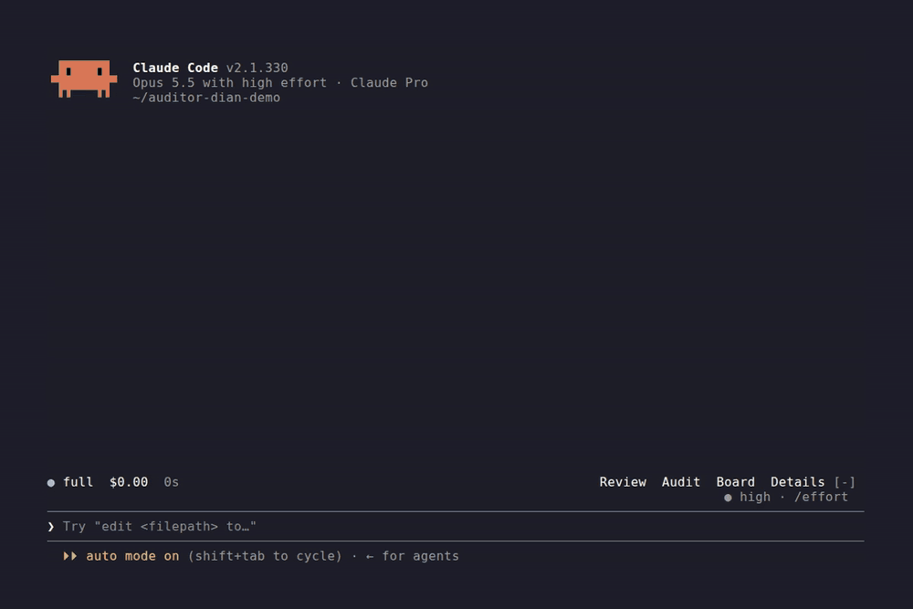
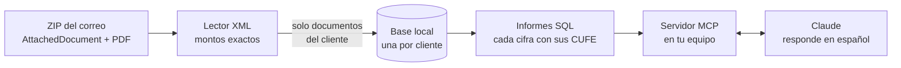

<p align="center">
  
</p>

<h1 align="center">Auditor DIAN</h1>

<p align="center">
  <strong>Las facturas electrónicas que recibe cada cliente, consultables desde Claude.<br>
  Cifras exactas, con los CUFE que las respaldan. Todo en tu equipo.</strong>
</p>

<p align="center">
  <a href="https://github.com/RafaGM1108/auditor-dian-core/actions/workflows/ci.yml"></a>
  
  <a href="https://github.com/RafaGM1108/auditor-dian-core/releases/latest"></a>
  
  <a href="LICENSE"></a>
</p>

<p align="center">
  <a href="#instalación-para-contadores">Instalación</a> ·
  <a href="#seguridad-y-privacidad">Seguridad</a> ·
  <a href="#qué-puedes-preguntar">Qué puedes preguntar</a> ·
  <a href="#cómo-funciona">Cómo funciona</a> ·
  <a href="#para-desarrolladores">Desarrolladores</a>
</p>

> [!IMPORTANT]
> **No es un producto oficial de la DIAN**, ni está afiliado a ella ni respaldado por ella. "DIAN" solo describe las facturas electrónicas que procesa. Las cifras son un apoyo y **requieren revisión de un contador**.

<p align="center">
  
  <br><sub>Demostración real con facturas sintéticas: registrar un cliente, cargar sus facturas y preguntar el IVA del bimestre.</sub>
</p>

## Por qué existe

En Colombia se emiten más de 2.300 millones de facturas electrónicas al año, y cada una le llega al comprador como un ZIP con un XML firmado. Para saber cuánto IVA hubo en el bimestre, qué compras son a crédito o qué facturas se anularon, el contador tiene que abrirlas una por una o depender del software contable de cada cliente.

Auditor DIAN lee esos ZIP tal como llegan al correo, guarda cada cliente en su propia base y deja que Claude responda en lenguaje natural. **El modelo no calcula nada**: cada cifra sale de una consulta SQL sobre los documentos y viene con la lista de CUFE que la respalda, para que puedas verificarla.

## Seguridad y privacidad

Está pensado para manejar información tributaria de terceros. Estas son las garantías y cómo se cumplen:

| Garantía | Cómo se cumple |
| --- | --- |
| **Tus facturas no salen del equipo** | Las bases y los archivos se quedan en tu computador. El código no hace llamadas de red, y el lector de XML tiene desactivados la red y las entidades externas (protección contra XXE). |
| **Nada se borra ni se modifica** | Las consultas abren la base en solo lectura. Cargar solo agrega, y repetir una carga no duplica nada: cada archivo se reconoce por su SHA-256 y cada documento por su CUFE. Exportar crea un Excel nuevo y nunca sobrescribe uno existente. |
| **La información de un cliente nunca termina en otro** | Cuatro filtros independientes, basados en la identificación que trae cada documento: al cargar, al abrir la base, al consultar y al repartir por cliente. Si cargas facturas que no son del cliente, no se guardan y Claude te lo dice ([decisión 0011](docs/decisiones/0011-filtros-entre-clientes.md)). |
| **Las cifras son exactas y trazables** | Montos en decimal exacto, nunca en coma flotante, guardados tal como vienen en el XML. Cada total trae sus CUFE. |
| **Los archivos maliciosos no lo tumban** | Tope de tamaño por XML leído con un límite real, no el que declara el ZIP. Un archivo dañado se registra y se salta sin afectar a los demás. |
| **Se puede auditar** | Código abierto con licencia MIT, 142 pruebas con 100 % de cobertura exigida en cada cambio, y cada decisión de diseño documentada en [`docs/decisiones/`](docs/decisiones/README.md). |

> [!NOTE]
> **Qué ve Claude.** Claude no lee tus archivos ni tus bases: solo recibe lo que cada herramienta responde (cifras, CUFE, nombres y NIT de proveedores), y eso se procesa como cualquier otra conversación con Claude. El diagnóstico para soporte no incluye montos ni contenido de facturas.

Para reportar una vulnerabilidad, mira [SECURITY.md](SECURITY.md).

## Instalación para contadores

No hace falta saber programar ni contratar un servidor.

1. Instala [Claude Desktop](https://claude.ai/download) e inicia sesión.
2. Descarga **`auditor-dian-<versión>.mcpb`** de la [última versión](https://github.com/RafaGM1108/auditor-dian-core/releases/latest) y ábrelo con doble clic. También puedes instalarlo desde Claude Desktop, en *Configuración → Extensiones → Configuración avanzada → Instalar extensión*.
3. Elige la **carpeta de datos**, donde se guardan las bases de tus clientes. La primera vez, Claude Desktop instala lo necesario en un par de minutos.
4. Descarga las facturas del correo como siempre y escríbele a Claude: ***Carga mis facturas***.

Claude revisa tu carpeta de Descargas y reparte cada factura al cliente que aparece como comprador. Si encuentra compradores que todavía no tienes registrados, te los muestra con su nombre para que decidas si los creas.

- **Sin rutas:** nombra las carpetas como las ves, por ejemplo *"la carpeta facturas enero del Escritorio"*.
- **El NIT como lo escribas:** *900.000.009-0*, *9000000090* o *C.C. 79.123.456*. El dígito de verificación se interpreta solo.
- **Repetir es seguro:** cargar dos veces lo mismo no duplica nada.

<details>
<summary><strong>Usarlo desde claude.ai o el celular, sin sacar las facturas del equipo</strong></summary>

El servidor sigue corriendo en tu computador; un túnel gratuito ([Tailscale Funnel](https://tailscale.com/kb/1223/funnel)) le da una dirección pública fija para que Claude lo alcance desde la web o la app. El computador tiene que estar encendido. Detalles en la [decisión 0014](docs/decisiones/0014-servidor-por-http-con-tunel.md).

1. Instala el comando `auditor`: `uv tool install git+https://github.com/RafaGM1108/auditor-dian-core`.
2. Instala [Tailscale](https://tailscale.com/download), inicia sesión (`sudo tailscale up`) y publica el puerto: `tailscale funnel --bg 8765`. La primera vez te pide activar HTTPS y Funnel en tu cuenta. Anota la dirección que muestra, por ejemplo `mi-pc.colibri.ts.net`.
3. Inicia el servidor: `auditor mcp --http --dominio mi-pc.colibri.ts.net`.
4. En claude.ai, *Configuración → Conectores → Agregar conector personalizado*, con la URL `https://mi-pc.colibri.ts.net/mcp/<token>` y sin inicio de sesión. El token está en `~/.auditor-dian/token-mcp`.

> [!WARNING]
> **La URL completa es una contraseña**: quien la tenga puede consultar y cargar facturas en tu equipo. No la compartas. Para cambiarla, borra `~/.auditor-dian/token-mcp` y reinicia el servidor.

</details>

## Qué puedes preguntar

| Pregunta | Qué responde |
| --- | --- |
| *¿Cuánto IVA en compras hubo en el bimestre 1 de 2026?* | El IVA por tarifa, neto de notas crédito, con sus CUFE |
| *¿Cuánto le compró a cada proveedor en el primer semestre?* | Totales por NIT, con notas crédito y de ajuste restadas |
| *¿Qué facturas a crédito llegaron en marzo?* | Proveedor, valor y vencimiento |
| *¿Hay facturas repetidas o anuladas?* | Posibles duplicados y anulaciones totales o parciales |
| *¿Qué retenciones traen las facturas?* | Autorretenciones declaradas por el emisor, por tipo |
| *¿Ya tengo registrada a Mi Cliente SAS? ¿Qué meses tiene cargados?* | El historial del cliente: documentos por tipo y por mes, y cada carga |
| *Exporta el informe de IVA a un Excel en mi escritorio* | Un `.xlsx` nuevo con hojas de resumen y detalle |

<details>
<summary><strong>Las 14 herramientas que Claude puede usar</strong></summary>

| Herramienta | Título | Efecto |
| --- | --- | --- |
| `listar_clientes` | Buscar clientes | Lectura |
| `historial_cliente` | Historial del cliente | Lectura |
| `buscar_documentos` | Buscar facturas | Lectura |
| `resumen_periodo` | Resumen de compras, IVA y retenciones | Lectura |
| `facturas_credito` | Facturas a crédito | Lectura |
| `duplicados_y_anulaciones` | Facturas repetidas y anuladas | Lectura |
| `compras_por_proveedor` | Compras por proveedor | Lectura |
| `iva_compras_por_bimestre` | IVA en compras por bimestre | Lectura |
| `no_validadas` | Facturas sin validación DIAN | Lectura |
| `diagnostico` | Diagnóstico para soporte | Lectura, sin montos |
| `exportar_informe` | Exportar informe a Excel | Crea un archivo nuevo |
| `crear_cliente` | Registrar cliente | Agrega |
| `ingerir_facturas` | Cargar facturas de un cliente | Agrega |
| `ingerir_por_cliente` | Cargar facturas y repartir por cliente | Agrega |

Ninguna herramienta borra ni modifica datos.
</details>

## Cómo funciona



**Documentos que lee:** factura de venta, factura de exportación, instrumento electrónico de transmisión (tipo 03), notas crédito y débito, documento soporte y nota de ajuste. Para cada uno determina si fue validado por la DIAN, a partir de la respuesta que trae el contenedor.

**Informes:** compras por proveedor, IVA de compras por bimestre, retenciones, facturas a crédito, duplicados y anulaciones, y documentos sin validar. Todos se exportan a Excel.

**Verificado con datos reales.** 57 facturas de 20 emisores, de 2020 a 2026, se leen sin errores. Contra el PDF que el propio emisor incluye en el ZIP, 53 coinciden exacto y las 4 restantes se explican: tres porque el PDF redondea y una porque el PDF es una imagen. Las rutas del XML están cotejadas con el Anexo Técnico de Factura Electrónica 1.9 ([detalle](docs/investigacion/anexo-tecnico.md)).

## Si algo falla o una cifra no cuadra

Pídele a Claude *"dame el diagnóstico de Auditor DIAN"* y abre un [reporte](https://github.com/RafaGM1108/auditor-dian-core/issues/new/choose) con los formularios **Algo salió mal** o **Una cifra no cuadra**. El diagnóstico trae la versión, los clientes, el número de documentos y las advertencias de lectura, sin montos ni contenido de facturas.

> [!WARNING]
> No adjuntes facturas reales en un reporte público. Si una cifra no cuadra, di cuál esperabas y de qué documento la sacaste.

## Para desarrolladores

Requiere [uv](https://docs.astral.sh/uv/) y Python 3.11 o superior.

```bash
uv sync
uv run pytest            # 142 pruebas
uv run ruff check .
```

**Línea de comandos**

```bash
uv run auditor clientes crear 900000009 --nombre "Cliente SAS"
uv run auditor ingerir 900000009 ~/facturas/        # ZIP, XML o carpeta
uv run auditor informe 900000009 iva_compras_por_bimestre --desde 2026-01-01 --hasta 2026-02-28 --xlsx iva.xlsx
```

Las bases viven en `~/.auditor-dian/`, o en la carpeta que indique `AUDITOR_DIAN_HOME`.

<details>
<summary><strong>Conectar el servidor MCP a mano</strong></summary>

En Claude Code, desde la carpeta del repositorio:

```bash
claude mcp add auditor -- uv run --directory "$PWD" auditor mcp
```

En Claude Desktop, en `claude_desktop_config.json`:

```json
{"mcpServers": {"auditor": {"command": "uv", "args": ["run", "--directory", "/ruta/a/auditor-dian-core", "auditor", "mcp"]}}}
```

**Empaquetar la extensión.** `./scripts/empaquetar_mcpb.sh` arma `dist/auditor-dian-<versión>.mcpb` y requiere `uv` y `npx`.

**Modo desarrollo.** Con `--desarrollo`, el script arma "Auditor DIAN (desarrollo)", que ejecuta el código en modo editable desde el repositorio: tras cada cambio basta con desactivar y volver a activar la extensión. Solo funciona en la máquina donde se armó.
</details>

<details>
<summary><strong>Plugins</strong></summary>

Un paquete aparte puede agregar informes, herramientas MCP o lectores de documentos. Lo declara en su `pyproject.toml`:

```toml
[project.entry-points."auditor_dian.plugins"]
mi_plugin = "mi_paquete:register"
```

`register(app)` recibe la interfaz de [`plugins.py`](src/auditor_dian/plugins.py), con un ejemplo completo en [`tests/plugin_ejemplo.py`](tests/plugin_ejemplo.py). Un plugin no puede reemplazar nada del núcleo, y uno que falla se reporta y se salta sin afectar lo demás.
</details>

## Documentación

- [`SPEC.md`](SPEC.md): alcance y reglas del proyecto.
- [`docs/decisiones/`](docs/decisiones/README.md): cada decisión de diseño, con sus alternativas descartadas.
- [`docs/investigacion/`](docs/investigacion/README.md): cifras, normas y herramientas existentes, con fuentes públicas.
- [`docs/bitacora.md`](docs/bitacora.md): qué se hizo y qué se aprendió en cada sesión.

## Licencia

[MIT](LICENSE). Puedes usarlo, modificarlo y distribuirlo libremente, sin garantía. Las cifras siempre requieren revisión de un contador.
